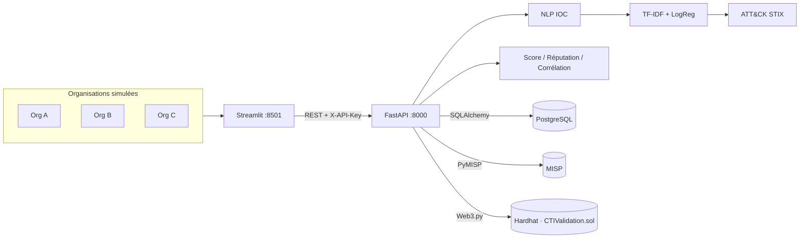

# Plateforme CTI intelligente et décentralisée

Prototype académique (ENSA Marrakech — module *IA avancée et Blockchain*) d'une plateforme collaborative de
**Cyber Threat Intelligence** : trois organisations simulées (A, B, C) importent des rapports, la plateforme
extrait et normalise les IOC, classe la menace (ML), propose des techniques **MITRE ATT&CK**, partage le
renseignement dans **MISP**, ancre son empreinte **SHA-256 sur Ethereum** et organise une **validation
collaborative par smart contract**, avec un **score de fiabilité explicable**, une **réputation dynamique** et
une **corrélation** entre rapports. Interface **Streamlit** avec thèmes sombre / clair.

> Références : `Cadrage_Projet_2i2ay.pdf` et `CDC_2I2AY.pdf` (dossier parent). Toutes les données de
> démonstration sont **synthétiques** (IP RFC 5737, domaines RFC 2606/6761) — aucune action offensive.

## Ce qui fonctionne réellement (vérifié)

| Brique | État | Preuve |
|---|---|---|
| FastAPI + PostgreSQL 16 + Alembic | intégré | 35 opérations OpenAPI, migrations 0001–0003 appliquées en Docker (tête `0003`) |
| Extraction / normalisation / doublons / incohérences IOC | intégré | corpus P=R=1,00 ; jeu *challenge* indépendant P=0,968 R=1,00 |
| Classification TF-IDF + régression logistique | intégré (expérimental) | test : accuracy 0,875, macro-F1 0,874 (16 docs) ; CV imbriquée groupée 0,876 ± 0,094 ; comparée à 6 autres approches ([ML_EVALUATION](docs/ML_EVALUATION.md)) |
| Enrichissement MITRE ATT&CK (STIX officiel v20.1) | intégré | 706 techniques, 55 règles ; P=0,62 R=0,76 vs annotations |
| MISP **réel** (misp-docker 2.5.51) via PyMISP | intégré | événements, attributs, tags, recherche ; tests *live* |
| Adaptateur MISP **simulé** | secours de développement | signalé « SIMULÉ » dans l'interface |
| Smart contract `CTIValidation.sol` (Hardhat) | intégré | 21 tests Hardhat ; transactions réelles via Web3.py |
| Score S = 0,30R + 0,30Q + 0,40V, réputation, corrélation | intégré | tests unitaires + scénario ; corrélation P=1,00 R=0,81 |
| Streamlit (8 pages, thèmes sombre/clair, responsive) | intégré | 19 tests `AppTest` ; audit mobile / tablette / bureau ; contraste WCAG des 16 vues |
| Scénario de démonstration (20 étapes + contrôles) | **réussi** (24/24) | `docs/test-reports/demo_scenario_run.json` |
| Tests | **réussis** | backend 85 (couverture 76 %), interface 19, contrat 21, *live* 4/4 (MISP réel et chaîne) ; scénario 24/24 rejoué après la mise à jour des dépendances ([TESTING_AND_VALIDATION](docs/TESTING_AND_VALIDATION.md)) |
| Reproductibilité | vérifiée | images épinglées par digest, `requirements.lock`, installation depuis les seuls fichiers versionnables ([INSTALLATION_GUIDE](docs/INSTALLATION_GUIDE.md)) |
| Sécurité | vérifiée | gitleaks : aucune fuite ; pip-audit : 0 vulnérabilité connue après mise à jour ([SECURITY_AUDIT](docs/SECURITY_AUDIT.md)) |
| Pipeline GitLab CI (13 jobs) | **écrite, validée localement, jamais exécutée sur GitLab** | [GITLAB_CI_CD](docs/GITLAB_CI_CD.md) |

Les limites (corpus synthétique, réseau Hardhat en mémoire, gouvernance centralisée du registre, etc.) sont
détaillées dans [docs/10_limites.md](docs/10_limites.md).

## Démarrage rapide

Prérequis : Docker Desktop (≥ 8 Go alloués si MISP est lancé), Python 3.11 (scripts utilitaires).

```bash
python scripts/generate_env.py
```

```bash
docker compose --profile misp up -d --build
```

Puis : interface **http://localhost:8501** · API/Swagger **http://localhost:8000/docs** · MISP **https://localhost:8443**
(MISP met 3 à 5 minutes à s'initialiser au premier démarrage ; sans le profil `misp`, l'adaptateur simulé prend le relais).

Scénario de démonstration complet contre la pile en marche :

```bash
python scripts/run_demo_scenario.py
```

Détails : [installation](docs/06_installation.md) · [utilisation](docs/08_guide_utilisation.md) ·
[dépannage](docs/07_troubleshooting.md).

## Architecture (résumé)



**Off-chain** : rapports, IOC, analyses, scores, audit (PostgreSQL) et partage CTI (MISP).
**On-chain** : identifiant, empreinte SHA-256 du rapport canonisé, adresses, votes, statut, réputation protocolaire.

## Documentation

| Document | Contenu |
|---|---|
| [Documentation complète / soutenance](docs/PROJECT_COMPLETE_DOCUMENTATION.md) | point d'entrée : objectifs, résultats, limites, scénarios, questions du jury |
| [Architecture](docs/ARCHITECTURE.md) | vue logique, flux de données, déploiement, choix technologiques |
| [Guide d'installation](docs/INSTALLATION_GUIDE.md) · [Guide utilisateur](docs/USER_GUIDE.md) | installation pas à pas, usage par rôle |
| [Évaluation ML](docs/ML_EVALUATION.md) · [Tests et validation](docs/TESTING_AND_VALIDATION.md) | métriques, protocoles, preuves |
| [Audit de sécurité](docs/SECURITY_AUDIT.md) · [CI/CD GitLab](docs/GITLAB_CI_CD.md) | secrets, dépendances, pipeline |
| [Rapport final](docs/FINAL_PROJECT_REPORT.md) · [Conformité](docs/REQUIREMENTS_TRACEABILITY.md) | bilan, exigences CDC / cadrage |
| [01 — Analyse des exigences](docs/01_analyse_exigences.md) | synthèse, matrice de traçabilité, contradictions et décisions |
| [02 — Architecture](docs/02_architecture.md) | composants, diagrammes de séquence, séparation on/off-chain, sécurité |
| [03 — Blockchain](docs/03_blockchain.md) | contrat, règle de majorité, réputation protocolaire, intégrité |
| [04 — API](docs/04_api.md) | endpoints, authentification, codes d'erreur, exemples |
| [05 — Évaluation](docs/05_evaluation.md) | corpus, pipeline ML, métriques, IOC, MITRE, corrélation |
| [06 — Installation](docs/06_installation.md) | Docker, configuration, exécution locale |
| [07 — Dépannage](docs/07_troubleshooting.md) | problèmes connus et solutions |
| [08 — Guide d'utilisation](docs/08_guide_utilisation.md) | les 8 pages, scénario de soutenance |
| [09 — Rapport de tests](docs/09_rapport_tests.md) | tests réellement exécutés et résultats |
| [10 — Limites et perspectives](docs/10_limites.md) | limites scientifiques et techniques |
| [data/README.md](data/README.md) | corpus, schémas, annotation, découpage |

## Structure du dépôt

```
backend/      FastAPI (app/: api, core, database, models, schemas, services, nlp, ml, mitre, misp, blockchain, correlation)
              alembic/ (migrations), tests/ (pytest), scripts/ (MITRE, évaluations)
blockchain/   contracts/CTIValidation.sol, test/ (Hardhat), scripts/ (déploiement, santé)
frontend/     app.py, views/ (8 pages), components/ (api, ui, charts, theme), .streamlit/
data/         raw/, annotated/, splits/, demo/, scripts/ (construction du corpus)
docker/       Dockerfiles backend / frontend / hardhat, entrypoint
docs/         documentation + test-reports/
scripts/      generate_env.py, run_demo_scenario.py, verify_consistency.py, audit_chain_anchors.py
.gitlab-ci.yml  pipeline CI (validate, lint, security, test, ml-validation, build, integration, report)
```

## Sécurité

Aucun secret dans le code : tout passe par `.env` (non versionné, généré aléatoirement). Clés API par organisation
(stockées hachées), contrôle d'accès par organisation, TLP:RED privé, validation Pydantic stricte, limites de taille
et de type de fichiers, ports liés à `127.0.0.1`, journal d'audit des opérations sensibles, erreurs sans fuite
d'information interne. Voir [docs/02_architecture.md](docs/02_architecture.md#sécurité).
