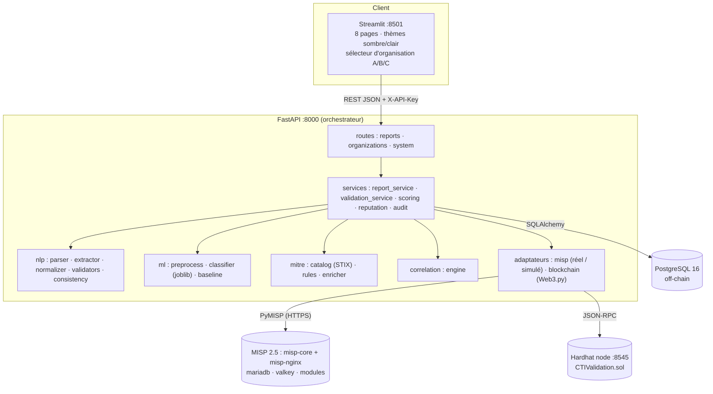
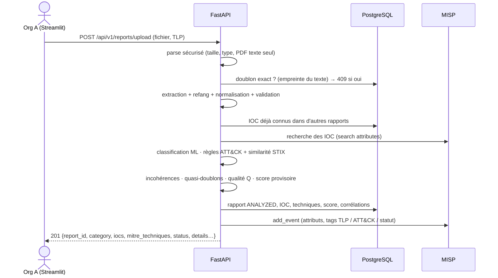
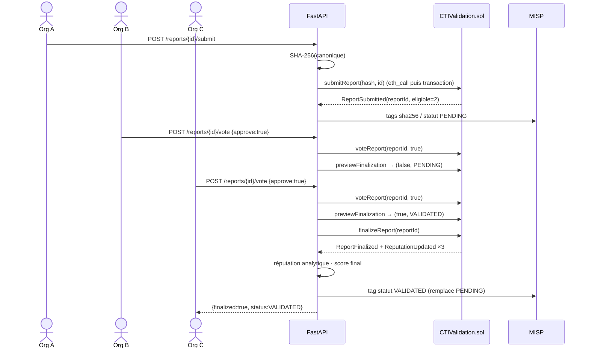

# 02 — Architecture technique

## 1. Vue d'ensemble

Le backend est le seul composant qui parle à PostgreSQL, MISP et Ethereum ; le frontend ne contient aucune logique
métier. Les adaptateurs isolent les dépendances externes (MISP réel / simulé, client Web3 / double de test).

## 2. Séparation on-chain / off-chain

| Donnée | Emplacement | Raison |
|---|---|---|
| Texte du rapport, titre, provenance, TLP | PostgreSQL + attribut `text` MISP | volumineux, potentiellement sensible |
| IOC normalisés, contexte, drapeaux, confiance d'extraction | PostgreSQL + attributs MISP (`to_ids=false`) | données d'analyse |
| Classification, techniques ATT&CK, anomalies, qualité | PostgreSQL (+ tags MISP pour ATT&CK) | dérivées, recalculables |
| Scores, historique de réputation analytique, corrélations, audit | PostgreSQL | explicabilité, historique |
| Empreinte SHA-256 du rapport canonisé, identifiant externe | **Ethereum** | intégrité, horodatage |
| Adresses des organisations, votes, statut | **Ethereum** | validation collaborative traçable |
| Réputation protocolaire bornée | **Ethereum** | règle du protocole, non falsifiable par le backend |

**Canonicalisation (`core/canonical.py`, version `cti-report/v1`)** : JSON trié, sans espaces superflus, UTF-8 ;
texte normalisé NFC, fins de ligne `\n`, espaces de fin supprimés ; IOC dédoublonnés et triés ; champs : identifiant,
titre, texte, source, date de publication, TLP, organisation émettrice, IOC non mal formés. Les résultats d'analyse
(ML, ATT&CK) sont **exclus** pour qu'un ré-entraînement ne casse pas la vérification. La même fonction sert à la
soumission et à la vérification.

## 3. Diagrammes de séquence

### 3.1 Import et analyse

### 3.2 Validation collaborative

## 4. Dépendances entre composants

| Composant | Dépend de | Comportement si indisponible |
|---|---|---|
| Analyse | extracteur, classifieur (repli : baseline à mots-clés), catalogue ATT&CK | toujours disponible |
| MISP | instance réelle (mode `real`/`auto`) | `auto` : adaptateur simulé signalé ; `real` : `misp_sync_status=FAILED`, l'analyse aboutit, resynchronisation via `POST /reports/{id}/misp` |
| Ethereum | nœud Hardhat + fichier de déploiement | `503 blockchain_error` ; le rapport reste `ANALYZED`, soumission possible plus tard |
| Réseau Hardhat redémarré | — | ancrages précédents détectés (`chain_anchor_mismatch`), signalés dans l'interface |

## 5. Choix de conception

* **Règles métier dans le contrat** (double vote, auto-validation, éligibilité, majorité) : le backend les simule
  par `eth_call` avant d'envoyer la transaction et décode les erreurs Solidity personnalisées en `409`.
* **Instantané des validateurs éligibles** à la soumission : une organisation enregistrée après coup ne peut pas voter
  (protection contre l'ajout d'identités opportunistes).
* **Finalisation automatique** après le vote qui rend l'issue déterminable (`ETH_AUTO_FINALIZE`).
* **Comptes Ethereum** : comptes déverrouillés du nœud Hardhat par index (aucune clé privée dans le code) ou signature
  locale si `ORG_X_PRIVATE_KEY` est fournie.
* **Thèmes** : options natives `theme.*` de Streamlit modifiées à chaud + jetons de couleur pour les éléments
  personnalisés (voir `frontend/components/theme.py`).

## 6. Sécurité

| Mesure | Implémentation |
|---|---|
| Secrets | `.env` non versionné, généré par `scripts/generate_env.py` (CSPRNG) ; jamais affichés ni journalisés |
| Authentification | en-tête `X-API-Key`, clés stockées hachées SHA-256, comparaison à temps constant |
| Autorisation | émetteur seul pour analyser/soumettre/synchroniser ; non-émetteur pour voter ; TLP:RED visible par l'émetteur seul et non partageable on-chain |
| Entrées | Pydantic strict (`extra=forbid`, énumérations, longueurs, motifs ATT&CK, URL http(s)) |
| Fichiers | liste blanche d'extensions, contrôle du contenu (en-tête PDF, JSON, binaire), 5 Mo, 60 pages PDF, PDF chiffrés refusés, nom de fichier assaini |
| Blockchain | rôles vérifiés par le contrat, `Ownable` (enregistrement), `Pausable` (arrêt d'urgence) |
| Réseau | ports publiés sur `127.0.0.1` uniquement ; MISP en HTTPS (certificat auto-signé de laboratoire) |
| Traçabilité | `audit_logs` (succès et refus), événements Solidity, historique de réputation |
| Erreurs | format JSON homogène avec `request_id`, sans trace ni détail interne |
| En-têtes HTTP | `X-Content-Type-Options`, `X-Frame-Options`, `Cache-Control: no-store` ; CORS limité au frontend |
