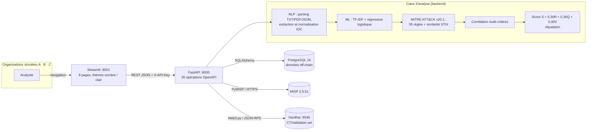
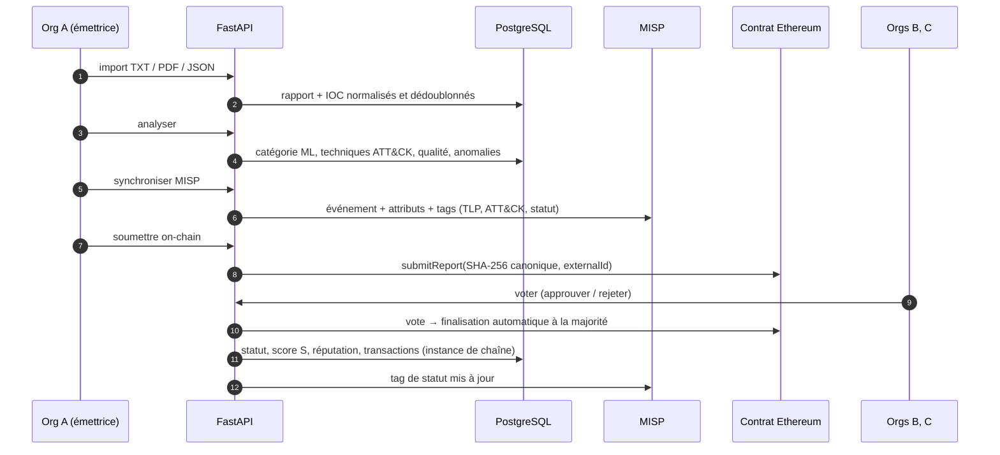

# Architecture de la plateforme

Document d'entrée pour l'architecture et la soutenance. Les diagrammes de séquence détaillés, la séparation
on-chain / off-chain et les mesures de sécurité applicative sont dans [`02_architecture.md`](02_architecture.md) ;
le contrat est décrit dans [`03_blockchain.md`](03_blockchain.md) et l'API dans [`04_api.md`](04_api.md).

## 1. Vue logique



## 2. Flux de données d'un rapport



Seuls l'empreinte, les votes, le statut et la réputation protocolaire vont sur la chaîne ; le texte et les IOC restent
hors chaîne (PostgreSQL et MISP). L'intégrité se vérifie en recalculant l'empreinte canonique.

## 3. Déploiement (Docker Compose)

| Service | Image (épinglée par digest) | Port publié | Santé | Données persistantes |
|---|---|---|---|---|
| `postgres` | `postgres:16-alpine` | `127.0.0.1:5432` (`POSTGRES_HOST_PORT`) | `pg_isready` | volume `pg_data` |
| `hardhat` | `node:22-bookworm-slim` + Hardhat 2.29.2 | `127.0.0.1:8545` | script `healthcheck.js` | aucune (réseau en mémoire) ; adresse du contrat dans le volume `deployments` |
| `backend` | `python:3.11-slim` + `requirements.lock` | `127.0.0.1:8000` | `GET /health` | — ; exécute `alembic upgrade head` au démarrage |
| `frontend` | `python:3.11-slim` + `requirements.lock` | `127.0.0.1:8501` | `/_stcore/health` | — |
| `misp-core`, `misp-nginx`, `misp-db`, `misp-redis`, `misp-modules`, `misp-certs` | images officielles misp-docker, MariaDB 10.11, Valkey 7.2 | `127.0.0.1:8443` (nginx) | `mariadb-admin ping`, `valkey-cli ping`, port PHP-FPM 9002, port modules 6666 ; nginx démarre après misp-core sain | volumes `misp_mysql`, `misp_configs`, `misp_logs`, `misp_files`, `misp_ssl`, `misp_gnupg` |

Les services MISP sont dans le profil Compose `misp` ; sans lui, le backend bascule sur l'adaptateur MISP simulé
(signalé dans l'interface). Tous les ports sont liés à `127.0.0.1`. Un réseau unique `cti-net` relie les services.

## 4. Choix technologiques

| Besoin | Choix | Justification | Alternative écartée |
|---|---|---|---|
| API | FastAPI + Pydantic v2 | validation stricte des entrées, OpenAPI généré, performances | Flask (validation manuelle) |
| Persistance | PostgreSQL 16 + SQLAlchemy 2 + Alembic | intégrité relationnelle, index partiels, migrations versionnées | MongoDB (pas de contraintes) |
| Extraction IOC | regex + refang + liste TLD IANA | déterministe, explicable, F1 0,98–1,00 mesuré | NER neuronal (corpus trop petit) |
| Classification | TF-IDF + régression logistique | meilleure ou égale aux autres modèles testés, interprétable (coefficients) | SGD, SVM, NB, RF (comparés, pas de gain significatif) |
| ATT&CK | catalogue STIX officiel + règles | traçable, versionné (v20.1) | annotation manuelle |
| Partage CTI | MISP + PyMISP | standard de la communauté CTI | format maison |
| Validation décentralisée | Solidity + OpenZeppelin + Hardhat | règles appliquées par le contrat, testables localement, sans coût | blockchain publique (coût, confidentialité) |
| Interface | Streamlit + Plotly | rapidité de développement, tests `AppTest` | React (coût de développement) |
| Industrialisation | Docker Compose, GitLab CI | reproductibilité, pipeline de contrôle | — |

## 5. Organisation du code

```
backend/app/
  api/routes/      reports, organizations, system
  services/        report_service, validation_service, scoring, reputation, serializers, audit
  nlp/             parsing, extraction, normalisation, validation des IOC
  ml/              preprocess, classifier (inférence), train, experiments, validate_model, baseline
  mitre/           catalog (STIX), rules, enricher
  correlation/     engine
  misp/            base, pymisp_adapter, simulated, factory
  blockchain/      client (Web3.py, identité d'instance)
  models/ schemas/ core/ database/
backend/alembic/versions/   0001 → 0002 → 0003
frontend/          app.py, views/ (8 pages), components/ (api, ui, charts, theme), tests/
blockchain/        contracts/CTIValidation.sol, test/, scripts/
data/              corpus annoté, splits, jeu externe ATT&CK, démonstration, scripts
scripts/           generate_env, run_demo_scenario, verify_consistency, audit_chain_anchors
```

## 6. Identité des ancrages blockchain

Le nœud Hardhat est en mémoire : après un redémarrage, le contrat est redéployé à la même adresse et les
identifiants recommencent à 1. L'identité d'un ancrage est donc le couple *(instance, id)*, l'instance étant le hash
du bloc de déploiement. Détails et tests : [`TESTING_AND_VALIDATION.md`](TESTING_AND_VALIDATION.md) §3.
